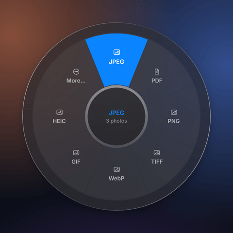
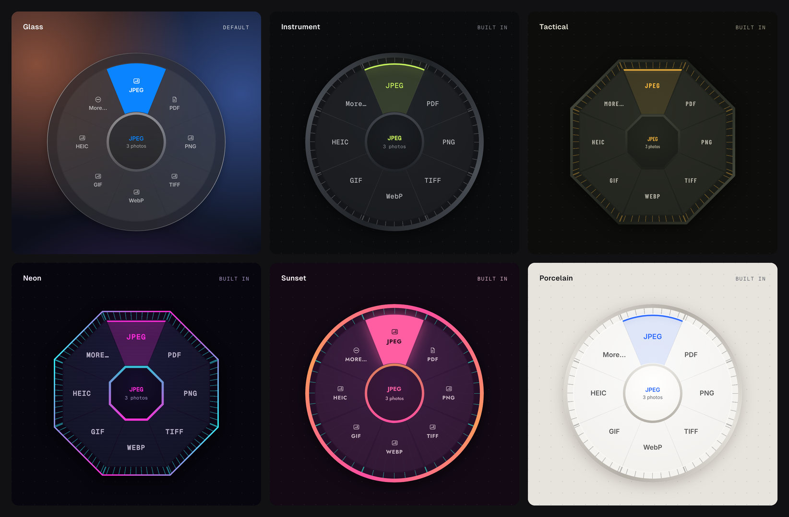

# Veer

<p align="center">
  
</p>

Convert and tidy files without leaving Finder. Drag files, hold **Shift**, and drop on a format. Hold **Command** for tools, **Control** for recipes. Everything runs on your Mac.

<p align="center">
  
  <br>
  <sub>Six built-in skins, or write your own in CSS. Previews rendered from Veer's design files.</sub>
</p>

Veer is a working name. Everything in this repository is original, clean-room work (see [Clean-room policy](#clean-room-policy)).

## Install

Veer is free. It runs on macOS 14 (Sonoma) or later, on Apple silicon and Intel Macs.

1. Download **Veer-‹version›.dmg** from the [latest release](../../releases/latest).
2. Open it and drag **Veer** into **Applications**.
3. Open Veer from Applications. It isn't notarized by Apple yet, so macOS blocks it the first time:
   - **macOS 15 Sequoia or later:** click **Done**. Open **System Settings → Privacy & Security**, scroll to "Veer was blocked to protect your Mac", click **Open Anyway**, and confirm with Touch ID or your password.
   - **macOS 14 Sonoma:** Control-click Veer in Applications, choose **Open**, then click **Open** again.

   If you're comfortable in Terminal, this clears the download flag instead, and Veer then opens normally:

   ```sh
   xattr -dr com.apple.quarantine /Applications/Veer.app
   ```

   macOS asks once per download, so again after each update.
4. For audio and video, install FFmpeg with [Homebrew](https://brew.sh). Images, PDFs and text work without it.

   ```sh
   brew install ffmpeg
   ```

### First steps

Veer lives in the menu bar (a circle-in-a-circle icon), not the Dock. The first time, it opens a short welcome guide.

- Start dragging files in Finder, then hold **Shift** to convert, **Command** for tools or **Control** for recipes. The wheel opens under the pointer: drop on a slot to run it, or in the middle to cancel. Results appear next to the originals, and nothing is overwritten.
- Prefer clicking? Use the menu bar icon (**Convert Files…**, **Tools for Files…**), or right-click files in Finder and choose **Services → Convert with Veer**.
- **Settings → Wheel** changes the wheel's style and skin.

Veer needs no Accessibility or Input Monitoring permission.

### Build from source

You need macOS 14 or later, Xcode or just the Command Line Tools (`xcode-select --install`), and [Rust](https://rustup.rs). Get the source (the **Code → Download ZIP** button, a release's source archive, or `git clone`), then in its folder run:

```sh
mac/scripts/run.sh
```

It builds Veer, installs it in Applications and starts it. An app built on your own Mac opens without the warning in step 3. For audio and video, install FFmpeg as in step 4.

## What's here

| Path | What it is |
| --- | --- |
| `crates/veer-core` | The conversion engine (Rust). Format detection, the conversion catalogue, image/PDF/text/media engines, never-overwrite publishing, batches and crash-isolated workers. |
| `crates/veer-cli` | The `veer` command: a CLI for power users, plus `veer serve`, the helper process the Mac app talks to. |
| `mac/` | The Mac app (Swift, AppKit + SwiftUI): menu bar item, drag detection, the wheel, progress HUD, settings, welcome window, Finder Services. `VeerKit` holds its unit-tested logic. `veer-vision` is a small helper the engine runs for text recognition and background removal (Apple's Vision framework). |
| `examples/recipes/` | Sample recipe files. |
| `docs/` | Guides: wheel styles and skins ([docs/skins.md](docs/skins.md)). |
| `deny.toml` | Licence policy: every dependency must be permissive. |

## What it does

- **Convert** images, PDFs, audio, video, documents, data files and subtitles (Shift wheel). A PDF converted to JPEG, PNG, WebP or TIFF gives one image per page.
  - **Documents**: TXT, Markdown, HTML, Word (.docx) and RTF all convert to each other and to PDF, keeping headings, lists, quotes, code, tables, bold, italic and links. A PDF converts to text or Markdown. On a Mac, PDFs are laid out by the system's text engine, with fonts for every script; elsewhere a built-in writer covers Western languages.
  - **SVG** is an image: PNG, JPEG, WebP, ICO and the rest, drawn sharp at **1×**, **2×** or **4×** (or at least 1024 px on its longest side by default), and **Resize…** redraws it at any size. SVG to PDF stays vector.
  - **Data**: CSV, TSV, JSON and Excel (.xlsx) convert to each other (numbers stay numbers, IDs with leading zeros stay text), and a table becomes a Markdown or HTML table or a PDF. A CSV made into Excel gets a bold header row that stays in view and fitted column widths; a workbook of several sheets becomes one CSV per sheet. **Combine into workbook** puts several tables into one .xlsx, a sheet each.
  - **Icons**: any picture or SVG converts to a macOS **ICNS** icon (16 to 1024 px) or an ICO.
  - **What's inside a folder**: drop a folder and the wheel offers **Images to JPEG**, **Images to WebP**, **Documents to PDF**, **Audio to MP3** and so on, for the kinds of file it holds. The results go into a copy of the folder ("Trip (JPEG)") with the same subfolders; files already in that format, or of other kinds, are left out, and anything that couldn't be converted is listed in "Not converted.txt".
  - **Folders and ZIPs**: a folder becomes a ZIP and a ZIP becomes a folder (**Unzip**). Extraction never writes outside its folder, skips links and Finder's `__MACOSX` clutter, and refuses archives that would expand absurdly (zip bombs).
- **Tools** (Command wheel). Tools ending in "…" open a window first:
  - **Resize…** by percentage, longest side, exact width or height.
  - **Crop…** with a live preview, aspect presets and pixel size.
  - **Redact…** with black boxes, pixelate or blur, previewed as they'll look. Video redaction is always black.
  - **Compress…** by quality level or to a target size such as 2 MB, with a before-and-after preview. **Smart** (the default) finds the smallest JPEG or WebP that still looks the same, by measuring visual similarity (SSIM) against the original instead of guessing a quality number. **Fit for** presets fill in sizes that get through email, Discord and WhatsApp. PDFs shrink too: their pictures are scaled down and recompressed.
  - **Split…** a PDF into every page, every few pages, or ranges like `1-3, 5, 8-`.
  - **Pages…** to reorder, delete and rotate single PDF pages.
  - **Page numbers…** in six positions and four styles ("3", "Page 3", "Page 3 of 12", "3 / 12"), with a live preview.
  - **Watermark…** faint text such as DRAFT, corner to corner or level, at the strength you choose.
  - **Password…** locks a PDF with a password (AES-256), or removes it when you know it. Passwords are never saved or logged.
  - **Trim…** audio or video with the system's trim handles; **Make GIF…** turns all or part of a video into a GIF.
  - **Save stills** saves ten evenly spaced frames from a video; **Even out volume** levels loudness to -16 LUFS, as podcasts do.
  - **Privacy check…** shows what files give away before you share them: GPS location (with Show in Maps), camera or phone and its serial number, names, dates, editing apps and edit history, and hidden content such as preview images, earlier versions kept inside PDFs, attachments, scripts and comment authors. **Remove Metadata** saves cleaned copies, and the report says what it can't remove.
  - **Make subtitles…** turns speech in a video or recording into SRT or WebVTT subtitles, or a plain transcript, with Apple's on-device speech recognition. The subtitles are saved next to the video under the same name, so players pick them up.
  - **Rename…** renames a batch with a pattern such as `Trip {date} {n}` (name, number, date taken, time, folder), previewed before anything changes.
  - **Remove background**: keeps the main subject on a transparent background (PNG, or WebP/TIFF if that's what you started with).
  - **Copy text**: recognises the text in pictures and scanned PDFs and puts it on the clipboard. Convert a picture to **Text** to save it as a file instead.
  - **Make searchable PDF**: turns photos of documents and scanned PDFs into PDFs you can search, select and copy from. Pages that already have text are left as they are.
  - **Documents**: **Word count** ("1,234 words · 6 min read", also on the clipboard), **Copy text** (the whole text, ready to paste), **Clean up text** (UTF-8, one kind of line ending, no trailing spaces), **Combine into one** (several notes into one file) and **Combine into PDF**, which takes any mix of documents, pictures, SVGs and PDFs. JSON gets **Format JSON** and **Minify JSON**, keeping key order and numbers exactly.
  - **Folders** (all on copies; the originals are only read): **Zip together** (anything selected, into one archive), **Merge folders** (identical files kept once, clashing names numbered), **Flatten** (every file at the top), **Sort by kind** (Images, Documents, Audio, Videos…), **List contents** (a tree with sizes, or a CSV with dates) and **Find duplicates** (a report of identical files and the space they take).
  - **Read QR code** puts what a QR code in a picture says on the clipboard (and shows it); **Make QR code** turns a text file (a link, Wi-Fi details) into a QR code picture.
  - **Make icons**: **Favicons** for a website (favicon.ico, PNG sizes, the Apple touch icon, a web manifest and the HTML to paste into `<head>`), a **macOS** .icns, or an **iOS** app icon set for Xcode. Pictures that aren't square are centred on a transparent square, never stretched.
  - **Hide faces** finds faces with Apple's Vision framework and pixelates, blurs or blacks them out, for sharing photos of people who didn't sign up for it.
  - **Translate…** translates documents (TXT, Markdown, HTML, Word, RTF) and subtitles (SRT, WebVTT) with Apple's on-device translation (macOS 26), keeping headings, lists, tables and timings; code isn't translated. "notes.md" becomes "notes (fr).md".
  - **Copy path**, **Copy name** and **Open in Terminal** (the folder itself, or a file's folder) for anything, in the app. **Share…** opens the share menu where the wheel was, with **AirDrop**, **Mail** and **Messages** as presets; **Copy image** puts one picture on the clipboard as an image, ready to paste into a chat or document.
  - One-step tools: rotate, remove metadata, combine into a PDF, copy SHA-256.
  - The wheel holds eight (Settings → Wheel can make it 6, 10 or 12); anything more is under **More…**. The slots you use most are the ones that stay, but nothing moves around: the most useful go up, right, down and left, and stay there.
- **Wheel styles** (Settings → Wheel): **Dial**, one ring, is the default. Turn on **Advanced styles** for **Orbit**, which adds an outer ring of presets behind each slot (JPEG → Smart or Best, Compress → Email or Discord), and **Bloom**, where resting on a slot or flicking past it fans out its presets. Slots stay in the same places in every style. The highlight glides between slots, borders are slightly sticky so it doesn't flicker, and a Force Touch trackpad taps as you cross into a slot. See [docs/skins.md](docs/skins.md).
- **Skins**: six built in (Glass, the plain system look and the default, plus Instrument, Tactical, Neon, Sunset and Porcelain), and your own as small CSS files of custom properties (`--accent: #00FF9C;`), starting from any built-in with `--base`. Veer picks up an edited skin the next time the wheel opens and lists any mistakes with line numbers. Reference: [docs/skins.md](docs/skins.md).
- **On-device intelligence**: text recognition, background removal and face detection use Apple's Vision framework, and translation uses Apple's Translation framework, on your Mac. Nothing is uploaded.
- **Recipes** (Control wheel): your own chains of steps. **Save as Recipe…** in a tool window keeps its settings for next time, and **Settings → Recipes** edits, duplicates and deletes them.
- **History** (menu bar → History…): the last 50 jobs, each with Undo. Undo moves results to the Trash, puts replaced originals back and restores old names after Rename.
- **Drag results out**: the progress window shows the results as an icon you can drag into Finder, Mail or any app (a copy; the files stay put). **Next…** opens the wheel again for the results, to keep going (convert to PDF, then compress it).
- **Convert Clipboard** (menu bar): converts files copied in Finder, or a copied image such as a screenshot, and puts the result back on the clipboard. A copied image's results go to Downloads.
- **Replace originals** (Settings → Output, off by default): originals go to the Trash, and a same-format result takes the original's name. Undo puts them back.
- **Watch folders** (Settings → Watch): files added to a folder are converted, compressed or run through a recipe automatically, into a `Converted` folder inside.
- **Command line and Shortcuts**: Settings → Advanced → Install Command-Line Tool links `/usr/local/bin/veer` to the app's helper.
- **AI agents (MCP)**: `veer mcp` is a Model Context Protocol server, so Claude and other AI apps can inspect, convert, compress, clean, subtitle and run recipes on your files, locally. Settings → Advanced → AI agents copies the configuration for Claude Desktop or Claude Code. Password tools aren't offered to agents.

## How it fits together

```
Finder drag + Shift ──▶ DragWatcher ──▶ WheelController ──inspect──▶ veer serve ──▶ catalog::wheel
                                              │                          │
                                         user drops                     run
                                              ▼                          ▼
                                     HUD (progress, Undo) ◀──events── job::run_batch ──▶ one `veer worker`
                                                                                         process per file
```

The wheel knows nothing about formats. The engine returns slots, each with an opaque `action`. The app sends that action back unchanged to run it. New conversions, tools or recipes in the engine show up on the wheel with no app changes.

## Build and test the engine (macOS or Linux)

```sh
cargo test --all               # ~100 unit and end-to-end tests
cargo build --release
./target/release/veer formats  # what converts to what on this machine
```

Optional helpers: `ffmpeg` (and `ffprobe`) for audio and video; macOS's built-in `sips` for HEIC/AVIF; [PDFium](https://github.com/bblanchon/pdfium-binaries) for PDF to image. Set `VEER_PDFIUM=/path/to/libpdfium.dylib` (or `.so`) to use PDFium outside the app; the PDF-to-image tests are skipped without it.

## Build the Mac app (macOS 14+, Xcode or the Command Line Tools)

```sh
mac/scripts/run.sh             # builds, replaces /Applications/Veer.app and starts it
mac/scripts/run.sh --check     # the same, plus a self-test of text recognition
```

`run.sh` uses `build-app.sh`, which on its own just makes `dist/Veer.app` (ad-hoc signed).

### Make a release

Pushing a tag such as `v0.2.0` runs `.github/workflows/release.yml`. It builds Veer for Apple silicon and Intel, smoke-tests the bundled helpers, and publishes `Veer-0.2.0.dmg`, a zip and their SHA-256 checksums on the Releases page, with the install steps from `docs/release-notes.md`. GitHub adds the source archives.

```sh
git tag v0.2.0
git push origin v0.2.0
```

`mac/scripts/make-dmg.sh` makes the same files in `dist/` on your own Mac. Set `UNIVERSAL=1` for both architectures and `VERSION=0.2.0` to stamp the version. Releases are ad-hoc signed and not notarized, which is why the first open needs the steps under [Install](#install). `build-app.sh` already takes a `SIGN_IDENTITY` for a Developer ID certificate, if you get one later.

The build script downloads a pinned PDFium build once (into `target/pdfium`) and bundles it next to the helper. `SKIP_PDFIUM=1` leaves it out, and the app then simply doesn't offer PDF to image.

To work on the wheel or its skins, `swift run --package-path mac VeerLab` opens the Wheel Lab: every style and state of the wheel, drawn by the app's own code, with a skin editor (see [docs/skins.md](docs/skins.md#the-wheel-lab)).

For development you can run the Swift app against a debug helper: `VEER_HELPER=$PWD/target/debug/veer swift run --package-path mac Veer`. The engine finds `veer-vision` next to itself in the app; elsewhere, point `VEER_VISION` at `$(swift build --package-path mac --show-bin-path)/veer-vision`. `veer-vision selftest` checks that text recognition and searchable PDFs work on this Mac.

The Mac app needs **no Accessibility or Input Monitoring permission**. It listens to global mouse events only, and polls the modifier keys and the drag pasteboard while a drag is in progress.

Swift tests cover the app's pure logic (`mac/Sources/VeerKit`): wheel hit-testing and placement for every style, the skin parser and the built-in skins, protocol framing and decoding, HUD state, the diagnostics log, the crop and redact editors, page ranges, the actions tool windows send, "Replace originals" naming and the watch-folder scanner. A contract test decodes a real `veer serve` session, and CI re-records that session with the freshly built helper, so an engine change that would break the app fails the build.

```sh
swift test --package-path mac   # needs full Xcode; the Command Line Tools have no XCTest
```

The app avoids `@State` and other SwiftUI macros, because their compiler plugin ships only with Xcode. Keep it that way so the app still builds with just the Command Line Tools.

### Other ways in

The drag gesture is the fast path, but every conversion is reachable without it:

- **Finder right-click → Services → Convert with Veer** (or **Veer Tools**)
- **Open With → Veer** on any file
- **⌃⌥V** in Finder opens the wheel for the selected files (Settings → General turns it off). The shortcut is only taken while Finder is in front, so other apps keep it. macOS asks once to let Veer read Finder's selection; Veer never reads keystrokes.
- The menu bar: **Convert Files…**, **Tools for Files…**, **Run a Recipe…**, **Convert Clipboard**, **Convert Finder Selection**

Each opens the wheel for keyboard use: arrow keys to choose, Return to run, Tab to switch wheels, Escape to cancel.

### Shortcuts

After **Settings → Advanced → Install Command-Line Tool…**, any shortcut can use Veer through a **Run Shell Script** action. Set **Pass Input** to **as arguments**, then use a script such as:

```sh
/usr/local/bin/veer convert --to jpeg "$@"
```

Other examples: `veer compress --target 2MB "$@"`, `veer resize --max 1600 "$@"`, `veer recipe "Web-ready image" "$@"`. Add `--json` to get one JSON line per file, which **Get Dictionary from Input** can read. Use the full path, because Shortcuts doesn't read your shell's `PATH`.

Native Shortcuts actions (App Intents) need Xcode's build tools, which this project deliberately doesn't require. They're on the roadmap for a release built with Xcode.

### Troubleshooting

Veer keeps a diagnostics log at `~/Library/Logs/Veer/veer.log`. It records what the drag watcher saw (pasteboard types, modifier keys, trigger decisions), wheel choices and helper restarts. It records file counts and extensions, never names or paths. **Menu bar → Troubleshooting → Copy Diagnostics** puts the system details and the last 200 log lines on the clipboard, ready to paste into a bug report.

## CLI

```sh
veer convert *.heic --to jpg              # one output per input, beside the original
veer convert talk.mkv --to mp4            # remuxes without re-encoding when codecs allow
veer convert report.pdf --to png          # one image per page (needs PDFium)
veer text receipt.jpg                     # prints the recognised text (macOS app)
veer convert scan.png --to txt            # saves it as scan.txt instead
veer searchable scan.pdf                  # "scan (searchable).pdf"
veer cutout portrait.jpg --crop           # transparent PNG trimmed to the subject
veer resize photos/*.jpg --max 1600 --out ~/Desktop/small
veer resize banner.png --width 1200       # exact width, keeps the aspect ratio
veer crop photo.jpg --rect 0.1,0.1,0.8,0.8 # fractions x,y,w,h: keeps the middle 80%
veer redact scan.png --rect 0.6,0.05,0.35,0.1 --style black
veer strip IMG_0042.jpg                   # lossless: drops GPS/EXIF, keeps orientation and colour profile
veer compress clip.mov --level strong
veer compress photo.jpg --target 500KB
veer split book.pdf --ranges "1-3, 5, 8-" # or --every 10; default: every page
veer pages deck.pdf --order 3 --order 1 --order 2 --rotate 1:90
veer numbers report.pdf --style page-of-total --position bottom-right --skip-first
veer watermark contract.pdf --text DRAFT --opacity 0.2
VEER_PASSWORD=secret veer protect statement.pdf # env keeps the password out of `ps`
VEER_PASSWORD=secret veer unlock "statement (protected).pdf"
veer trim interview.m4a --start 1:30 --end 12:05
veer gif clip.mov --start 3 --end 6.5
veer frames talk.mp4 --count 12 --format png
veer normalize podcast.wav
veer compress photo.jpg --level smart      # smallest file that still looks the same
veer privacy IMG_0042.jpg report.pdf      # what they reveal; veer strip removes it
veer subtitles talk.mp4 --language en-US  # talk.srt (--to vtt or txt); macOS app
veer mcp                                  # serve Veer's tools to an AI agent
veer combine scan1.png scan2.png notes.pdf  # documents and SVGs go in too
veer convert notes.md --to docx            # or pdf, html, rtf, txt; and back again
veer convert logo.svg --to png             # at least 1024 px; veer resize logo.svg --max 4096
veer convert orders.csv --to json          # csv, tsv, json, md and html tables
veer convert orders.csv --to xlsx          # and back: veer convert book.xlsx --to csv
veer workbook jan.csv feb.csv mar.csv      # "jan (combined).xlsx", a sheet each
veer convert Photos --to jpeg              # "Photos (JPEG)": the pictures inside, converted
veer codes poster.jpg                      # prints what its QR code says
veer qr wifi.txt                           # "wifi (QR code).png"
veer icons logo.svg --set favicon          # or --set mac (logo.icns), --set ios
veer faces party.jpg --style blur          # Vision; macOS app
veer translate notes.md --to fr            # "notes (fr).md"; macOS 26 app
veer words essay.docx                     # 1,234 words · 6 min read
veer join week1.md week2.md               # "week1 (combined).md"
veer json data.json --minify              # or without --minify to re-indent
veer clean notes.txt                      # UTF-8, \n line endings, no trailing spaces
veer zip Photos notes.txt                 # Archive.zip; veer convert Photos --to zip for one each
veer unzip Archive.zip
veer merge "Photos 2023" "Photos 2024"    # "Photos 2023 (merged)"
veer flatten Downloads                    # or: veer sort, veer list --csv, veer duplicates
veer checksum installer.dmg
veer recipe "Web-ready image" *.png
veer --json convert a.png --to webp       # JSON lines for scripts
```

Exit codes: `0` everything done or skipped, `1` at least one file failed, `2` usage error.

## Recipes

A recipe is a named chain of steps in a TOML file. Put recipes in `~/Library/Application Support/Veer/recipes/` (or `$VEER_RECIPES_DIR`), and they appear on the Control wheel and in `veer recipes`.

```toml
name = "Web-ready image"
description = "Longest side 2048 px, WebP at quality 80, no metadata"

[[steps]]
op = "resize"
max = 2048

[[steps]]
op = "convert"
to = "webp"
quality = 80

[[steps]]
op = "strip_metadata"
```

Steps: `convert {to, quality?}`, `resize {max | percent | width | height}`, `rotate {degrees}`, `crop {rect}`, `redact {rects, style?}`, `strip_metadata`, `compress {level?: light|balanced|strong|smart, target_bytes?}`, `pages {pages, rotate?}`, `page_numbers {position?, style?, start?, size?, skip_first?}`, `watermark {text, opacity?, size?, diagonal?}`, `trim {start?, end?}`, `normalize_audio`, `remove_background {crop?}`, `make_searchable`, `transcribe {to?: srt|vtt|txt, language?}`. A `rect` is `{x, y, w, h}` in fractions of the picture; times are in seconds. Image steps share one decode and one encode, so chains never compress twice.

You don't have to write TOML: **Save as Recipe…** in a tool window, or **Settings → Recipes**, writes the file for you. Saving never overwrites another recipe; a name that's taken gets a number. Passwords can't go in a recipe.

## Helper protocol (`veer serve`)

JSON, one object per line. Every request gets exactly one reply with the same `id`.

| Method | Params | Result |
| --- | --- | --- |
| `hello` | none | `version`, `protocol` (1), `capabilities` |
| `inspect` | `paths`, `recipes_dir?` | `files` (detected formats), `wheel` (`convert`, `tools`, `recipes` slots). A slot may carry `variants`: presets with a short `label`, a `hint` and their own `action`, shown by the Orbit and Bloom styles. |
| `run` | `paths`, `action`, `options?`, `isolate?` | `job`, `units`, then events: `item_started`, `item_progress`, `item_finished`, `job_finished`. An outcome lists everything it created in `outputs` (several page images, or one folder). |
| `cancel` | `job` | `cancelled` |
| `recipes` | `recipes_dir?` | `recipes` (built-ins marked `builtin`, the user's with their `path`), `errors` |
| `privacy` | `paths` | `reports`: per file, `findings` (`kind`, `label`, `detail`, `removable`, `latitude`/`longitude` for places) or an `error` |
| `save_recipe` | `recipe`, `recipes_dir?`, `replace?` | `path`. A new file never overwrites; `replace` rewrites one recipe file in the recipes folder. |
| `shutdown` | none | `{}`, then the helper exits |

When stdin closes (the app quit or crashed), the helper cancels its jobs and exits. A worker whose supervisor dies kills itself and its FFmpeg.

## Guarantees

- **Never overwrites.** Outputs are written to a hidden temporary file and hard-linked into place under a free name (`photo 2.jpg`), which fails if the name is taken. Originals are never modified; with "Replace originals" on, the app moves them to the Trash, where Undo can find them.
- **Tidy multi-file results.** Up to four pages or parts are saved next to the original; more go into one folder, such as `report (pages)`.
- **One bad file fails only itself.** Each file runs in its own worker process with a time limit. Crashes and hangs are reported per file, and partial outputs are deleted.
- **Upright and colour-correct.** EXIF orientation is applied to pixels, and ICC profiles are carried into PNG, JPEG, WebP, TIFF and PDF outputs.
- **Bounded inputs.** Images up to 40,000 px a side and 1 GiB decoded; PDFs decompress to at most 512 MB; text files up to 64 MB; SVGs drawn at most 16,384 px a side; ZIPs extract at most 1,000 times their size (and 64 GB); folders up to 500,000 items.
- **Local only.** No network access, accounts or telemetry.

## Clean-room policy

No code, assets or text were taken from other apps, and no other app's source code was opened. Behaviour was specified from public material only: websites, store listings and reviews. Every dependency is permissively licensed (MIT, Apache-2.0, BSD, Zlib, ISC), and `cargo deny check licenses` enforces this. See `THIRD_PARTY.md`.

## Known limits

- Resize and rotate refuse animated GIFs rather than flatten them. Converting an animated GIF to a still format keeps the first frame. Removing metadata from a GIF is lossless and keeps every frame.
- Word files are read for their text and structure: headings, lists, quotes, code, tables, bold, italic and links. Pictures, comments, footnotes, headers and footers aren't carried over, and Word output uses Calibri and simple styles. PowerPoint files aren't handled yet.
- Excel workbooks are read for their values: a formula gives the result Excel last saved, and formatting, charts and merged cells aren't carried over. Workbooks are refused if they'd unpack to more than 512 MB.
- Hide faces finds the faces Vision detects; very small, turned-away or covered faces can be missed, so check the result before sharing. Read QR code reads QR codes only, not other barcodes.
- Translate needs macOS 26 and the two languages downloaded in System Settings → General → Language & Region → Translation Languages. Each paragraph is translated as a whole, so bold or italic words inside one come out plain.
- Without the Mac app, documents become PDF through a built-in writer with the standard PDF fonts (Helvetica, Courier), which cover Western European languages; other letters print as "?".
- Password-protected ZIP files can't be opened yet, nor archives compressed with methods other than Deflate and Deflate64.
- Text recognition, Remove background and searchable PDFs need the Mac app (macOS 14 or later); the engine on Linux doesn't offer them. A searchable PDF made from a PDF is redrawn page by page, so links, form fields and bookmarks aren't carried over.
- PDF to image needs the bundled PDFium. Password-protected PDFs are refused by the other PDF tools; remove the password first with **Password…**.
- A PDF with only an owner password (editing restrictions, no password to open it) opens without one, so Veer's PDF tools treat it as unlocked and their results drop those restrictions.
- Make subtitles needs the Mac app (macOS 14 or later), permission for speech recognition (Veer asks the first time) and the language's on-device model, which macOS downloads when Dictation is turned on for it. macOS grants this per app, so from Terminal or an AI app subtitles work only if that app has been allowed speech recognition; Veer doesn't ask from there. Accuracy is that of macOS dictation: good for clear speech, weaker with music, crosstalk or strong accents.
- Smart compression measures JPEG and WebP; other formats use Balanced. It is honest: if the original is already as small as it can get without visible change, Veer says so instead of making a worse copy.
- Page numbers and watermarks use Helvetica, so they take Latin letters, numbers and punctuation only.
- Shrinking a PDF recompresses its 8-bit RGB and greyscale pictures; text, vector drawings and CMYK pictures are left as they are.
- Trim, Make GIF and Even out volume re-encode what they keep, so cuts are exact but take as long as a conversion.
- Crop and Redact need a preview, so the app can't crop video formats AVFoundation can't open (MKV, WebM, AVI). The CLI can.
- Compress to a target size for video needs `ffprobe` and works out a bitrate from the duration, so the result lands near the target rather than exactly on it.
- PDF to text only returns selectable text. Run **Make searchable PDF** on a scan first.

## Status

Version 1.0 in progress. Newest: Excel (both ways, and Combine into workbook), converting what's inside a folder, QR codes (read and make), icon sets (favicons, ICNS, iOS), Hide faces and Translate (on-device, through the Vision helper), Share and Copy image on the wheel, Next… in the progress window, and ⌃⌥V for Finder's selection. The engine side is tested on Linux end to end (faces and translation against a stand-in helper); the helper's real `faces` and `translate` commands and the new app pieces still need a run on a Mac. Before that: documents (TXT, Markdown, HTML, Word, RTF and PDF, converting every way, with word counts, cleanup and combining), SVG as an image drawn at any size, CSV/TSV/JSON, and folders and ZIPs (zip, unzip, merge, flatten, sort, list, find duplicates), plus Copy path, Copy name and Open in Terminal. All of it is tested on Linux end to end; the Mac's text-engine PDF layout (`veer-vision document-pdf`) and the app's quick actions still need a run on a Mac. Before that: wheel styles (Dial, plus Orbit and Bloom as advanced options) with presets from the engine, and skins written as CSS custom properties, with six built in. The wheel's tracking (dead zone, sticky borders, Orbit's ring line, Bloom's rest-or-flick) and the skin parser are unit-tested on Linux; the drawing itself still needs a look on a Mac. Before that: Privacy check, Make subtitles (on-device speech recognition), Smart compression and an MCP server for AI agents. Before that, the extras: PDF page numbers, watermarks, passwords, shrinking and single-page rotation; trim, GIF, stills and loudness for media; batch rename; History with multi-step undo; drag-out; Convert Clipboard; and a recipe editor. The engine is built and tested on Linux, including the end-to-end, protocol and PDFium tests, and its licences are checked with `cargo deny`. The Mac app builds with the Command Line Tools. Text recognition, Remove background and searchable PDFs are new: the engine side is tested against a stand-in helper, and `veer-vision selftest` (run by CI and by `run.sh --check`) checks the real one on a Mac.
