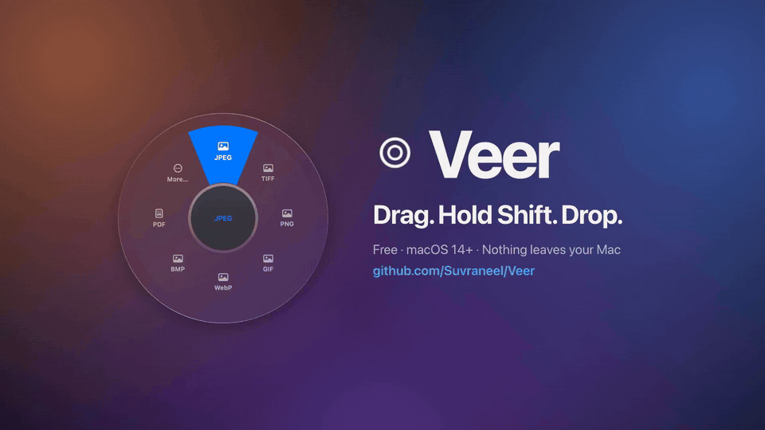

<div align="center">

<a href="https://cdn.jsdelivr.net/gh/Suvraneel/Veer@main/.github/media/demo.mp4"></a>

<h1>Veer</h1>

<p><strong>Convert and tidy files without leaving Finder.</strong><br>
Drag files, hold Shift, drop on a format. A free menu bar app for macOS that does all the work on your Mac.</p>

<p>
  <a href="https://cdn.jsdelivr.net/gh/Suvraneel/Veer@main/.github/media/demo.mp4"><strong>▶ Watch the 20-second demo</strong></a> (with sound)
  &nbsp;·&nbsp;
  <a href="#run-it-locally"><strong>Run it locally</strong></a>
</p>

<p>
  
  
  
  
  
</p>

</div>

## Why

Converting a file on a Mac usually means a detour: open Preview and export, or upload it to a converter website and download the result. Veer takes the drag you're already making and adds one key. Hold **Shift** mid-drag and a wheel of formats opens under the pointer. Drop on **JPEG** and the JPEGs appear next to the originals.

- **No window to open.** The wheel appears where the pointer is, in the middle of a Finder drag. Hold **Command** instead for tools, or **Control** for your own recipes.
- **Nothing leaves your Mac.** No network access, accounts or telemetry. Text recognition, background removal, face detection, subtitles and translation use Apple's on-device frameworks.
- **Nothing gets overwritten.** Results land beside the originals under a free name, and every job can be undone from History.

## How it works

```
Finder drag + Shift ──▶ DragWatcher ──▶ WheelController ──inspect──▶ veer serve ──▶ catalog::wheel
                                              │                          │
                                         user drops                     run
                                              ▼                          ▼
                                     HUD (progress, Undo) ◀──events── job::run_batch ──▶ one `veer worker`
                                                                                         process per file
```

Veer is two programs. The **Mac app** (Swift) spots the drag, draws the wheel and shows progress. The **engine** (Rust) does the work. It runs as `veer serve`, a helper process the app talks to in JSON lines over stdin and stdout.

1. **Spotting the drag.** The app listens to global mouse events and, only while a drag is in progress, polls the modifier keys and the drag pasteboard. That's why it needs no Accessibility or Input Monitoring permission.
2. **Filling the wheel.** The app sends the dragged paths to `inspect`. The engine detects each file's format and returns three sets of slots (convert, tools, recipes), each carrying an opaque `action`.
3. **Running the job.** On drop, the app sends that action back unchanged. The wheel knows nothing about formats, so a new conversion, tool or recipe in the engine shows up on the wheel with no app changes.
4. **One worker per file.** `job::run_batch` runs each file in its own `veer worker` process with a time limit. A crash or hang fails only that file, its partial outputs are deleted, and progress events stream back to the HUD.
5. **Helpers on demand.** For Apple's Vision, Speech and Translation frameworks, the engine runs `veer-vision`, a small Swift helper bundled in the app. Audio and video go through FFmpeg when it's installed, HEIC and AVIF through macOS's `sips`, and PDF to image through a bundled PDFium.

### Guarantees

- **Never overwrites.** Outputs are written to a hidden temporary file and hard-linked into place under a free name (`photo 2.jpg`), which fails if the name is taken. Originals are never modified. With "Replace originals" on, the app moves them to the Trash, where Undo can find them.
- **Tidy multi-file results.** Up to four pages or parts are saved next to the original; more go into one folder, such as `report (pages)`.
- **One bad file fails only itself.** Crashes and hangs are reported per file.
- **Upright and colour-correct.** EXIF orientation is applied to pixels, and ICC profiles are carried into PNG, JPEG, WebP, TIFF and PDF outputs.
- **Bounded inputs.** Images up to 40,000 px a side and 1 GiB decoded; PDFs decompress to at most 512 MB; text files up to 64 MB; SVGs drawn at most 16,384 px a side; ZIPs extract at most 1,000 times their size (and 64 GB); folders up to 500,000 items.
- **Local only.** No network access, accounts or telemetry.
- **Cleans up after itself.** When stdin closes (the app quit or crashed), the helper cancels its jobs and exits. A worker whose supervisor dies kills itself and its FFmpeg.

## Features

### The wheel

<p align="center">
  
  <br>
  <sub>Six built-in skins, or write your own in CSS. Previews rendered from Veer's design files.</sub>
</p>

- **Three wheels on one gesture.** **Shift** converts, **Command** opens tools, **Control** runs recipes. Drop on a slot to run it, or in the middle to cancel.
- **Styles** (Settings → Wheel). **Dial**, one ring, is the default. Turn on **Advanced styles** for **Orbit**, which adds an outer ring of presets behind each slot (JPEG → Smart or Best, Compress → Email or Discord), and **Bloom**, where resting on a slot or flicking past it fans out its presets. The highlight glides between slots, borders are slightly sticky so it doesn't flicker, and a Force Touch trackpad taps as you cross into a slot.
- **Slots that stay put.** The wheel holds eight (or 6, 10 or 12), and anything more is under **More…**. The slots you use most stay on the wheel, but nothing moves around: the most useful go up, right, down and left, and stay there.
- **Skins.** Glass (the plain system look and the default), Instrument, Tactical, Neon, Sunset and Porcelain, plus your own as small CSS files of custom properties (`--accent: #00FF9C;`), starting from any built-in with `--base`. Veer picks up an edited skin the next time the wheel opens and lists any mistakes with line numbers. See [docs/skins.md](docs/skins.md).

### Convert (Shift)

| Kind | What you get |
| --- | --- |
| **Images** | JPEG, PNG, WebP, HEIC, TIFF, GIF, BMP, ICO, ICNS, TGA and QOI to each other or to PDF (AVIF reads in too). A picture converts to **Text** through text recognition. A PDF converted to JPEG, PNG, WebP or TIFF gives one image per page. |
| **SVG** | Treated as an image: PNG, JPEG, WebP, ICO and the rest, drawn sharp at 1×, 2× or 4× (at least 1024 px on its longest side by default). SVG to PDF stays vector. |
| **Icons** | Any picture or SVG to a macOS ICNS (16 to 1024 px) or an ICO. |
| **Documents** | TXT, Markdown, HTML, Word (.docx) and RTF convert to each other and to PDF, keeping headings, lists, quotes, code, tables, bold, italic and links. A PDF converts to text or Markdown. |
| **Data** | CSV, TSV, JSON and Excel (.xlsx) convert to each other (numbers stay numbers, IDs with leading zeros stay text). A table also becomes a Markdown or HTML table, or a PDF. A workbook of several sheets becomes one CSV per sheet. |
| **Audio and video** | Through FFmpeg: MP3, M4A, WAV, FLAC, AIFF, OGG, Opus and WMA; MP4, MOV, WebM, MKV, AVI, WMV and GIF. Video is remuxed without re-encoding when the codecs allow. |
| **Subtitles** | SRT and WebVTT to each other or to plain text. |
| **Folders** | Drop a folder for **Images to JPEG**, **Documents to PDF**, **Audio to MP3** and so on. Results go into a copy of the folder ("Trip (JPEG)") with the same subfolders, and anything that couldn't be converted is listed in "Not converted.txt". |
| **ZIPs** | A folder becomes a ZIP and a ZIP becomes a folder. Extraction never writes outside its folder, skips links and `__MACOSX` clutter, and refuses zip bombs. |

### Tools (Command)

Tools ending in "…" open a window first, with a live preview where it helps.

| Group | Tools |
| --- | --- |
| **Images** | **Resize…** (percentage, longest side, exact width or height) · **Crop…** with aspect presets · **Redact…** with black boxes, pixelate or blur · Rotate · **Make icons** (favicons with the HTML for `<head>`, a macOS .icns or an iOS app icon set) |
| **Compress…** | By quality level or to a target size such as 2 MB. **Smart** (the default) finds the smallest JPEG or WebP that still looks the same by measuring visual similarity (SSIM), instead of guessing a quality number. **Fit for** presets fill in sizes that get through email, Discord and WhatsApp. PDFs shrink too. |
| **PDF** | **Split…** (every page, every few pages, or ranges like `1-3, 5, 8-`) · **Pages…** to reorder, delete and rotate · **Page numbers…** · **Watermark…** · **Password…** (AES-256; passwords are never saved or logged) · Combine into PDF · **Make searchable PDF** |
| **Audio and video** | **Trim…** · **Make GIF…** · **Save stills** (ten evenly spaced frames) · **Even out volume** (-16 LUFS, as podcasts do) · **Make subtitles…** as SRT, WebVTT or a transcript, with on-device speech recognition |
| **Privacy** | **Privacy check…** shows what a file gives away before you share it: GPS location, camera and serial number, names, dates, editing apps, and hidden content such as earlier versions kept inside PDFs. **Remove Metadata** saves cleaned copies. **Hide faces** pixelates, blurs or blacks out every face Vision finds. |
| **Text and AI** | **Copy text** from pictures and scanned PDFs · **Remove background** to a transparent PNG · **Translate…** documents and subtitles on device (macOS 26), keeping headings, lists, tables and timings · **Read QR code** / **Make QR code** |
| **Documents and data** | **Word count** ("1,234 words · 6 min read") · Copy text · **Clean up text** · **Combine into one** · **Format JSON** / **Minify JSON**, keeping key order and numbers exactly · **Combine into workbook** (several tables into one .xlsx, a sheet each) |
| **Folders** (on copies) | **Zip together** · **Merge folders** (identical files kept once) · **Flatten** · **Sort by kind** · **List contents** (a tree with sizes, or a CSV) · **Find duplicates** |
| **Everyday** | **Rename…** with a pattern such as `Trip {date} {n}`, previewed first · **Copy path** · **Copy name** · **Open in Terminal** · **Share…** (AirDrop, Mail and Messages as presets) · **Copy image** · Copy SHA-256 |

### Around the wheel

- **History** (menu bar → History…): the last 50 jobs, each with Undo. Undo moves results to the Trash, puts replaced originals back and restores old names after Rename.
- **Drag results out** of the progress window into Finder, Mail or any app, or press **Next…** to open the wheel again for the results (convert to PDF, then compress it).
- **Convert Clipboard** (menu bar): converts files copied in Finder, or a copied image such as a screenshot, and puts the result back on the clipboard.
- **Replace originals** (Settings → Output, off by default): originals go to the Trash, and a same-format result takes the original's name.
- **Watch folders** (Settings → Watch): files added to a folder are converted, compressed or run through a recipe automatically, into a `Converted` folder inside.
- **Recipes** (Control wheel): your own chains of steps. **Save as Recipe…** in a tool window keeps its settings, and **Settings → Recipes** edits them.
- **Other ways in.** Finder's right-click **Services → Convert with Veer** (or **Veer Tools**), **Open With → Veer**, **⌃⌥V** in Finder for the selected files, and the menu bar (**Convert Files…**, **Tools for Files…**, **Run a Recipe…**, **Convert Finder Selection**). Each opens the wheel for the keyboard: arrow keys to choose, Return to run, Tab to switch wheels, Escape to cancel.
- **Command line, Shortcuts and AI agents.** The same engine is the `veer` command. `veer mcp` is a Model Context Protocol server, so Claude and other AI apps can inspect, convert, compress, clean, subtitle and run recipes on your files, locally. Password tools aren't offered to agents. See [Reference](#reference).

## Tech stack

| Layer | Built with |
| --- | --- |
| Mac app | Swift 5.10 as a Swift package (no Xcode project), AppKit + SwiftUI, macOS 14+. It avoids SwiftUI macros so it builds with just the Command Line Tools. |
| On-device intelligence | Apple's Vision (text, subject masks, faces), Speech (subtitles), Translation (macOS 26) and the system text engine for PDF layout, all in the `veer-vision` helper |
| Engine and CLI | Rust 2021 (1.88+): `clap`, `serde`, `image` + `webp`, `lopdf`, `resvg` + `svg2pdf`, `pulldown-cmark`, `calamine` + `rust_xlsxwriter`, `zip`, `qrcode` + `rqrr`, `kamadak-exif` |
| Media | FFmpeg and ffprobe (optional, from Homebrew), macOS `sips` for HEIC and AVIF, PDFium for PDF to image |
| Protocols | JSON lines between app and engine (`veer serve`), Model Context Protocol for AI agents (`veer mcp`) |
| Quality | 204 Rust tests and 92 Swift tests, `rustfmt`, `clippy -D warnings`, `cargo deny` licence checks, GitHub Actions on Linux and macOS |

## Run it locally

There's no published release yet, so for now you build Veer yourself. You need macOS 14 or later, Xcode or just the Command Line Tools (`xcode-select --install`), and [Rust](https://rustup.rs).

```sh
git clone https://github.com/Suvraneel/Veer.git
cd Veer
mac/scripts/run.sh             # builds Veer, replaces /Applications/Veer.app and starts it
mac/scripts/run.sh --check     # the same, plus a self-test of text recognition
```

For audio and video, install FFmpeg. Images, PDFs and text work without it.

```sh
brew install ffmpeg
```

Veer lives in the menu bar (a circle-in-a-circle icon), not the Dock, and opens a short welcome guide the first time. Start dragging files in Finder, then hold **Shift**. An app built on your own Mac opens without Gatekeeper's warning.

### The engine on its own (macOS or Linux)

```sh
cargo test --all               # about 200 unit and end-to-end tests
cargo build --release
./target/release/veer formats  # what converts to what on this machine
```

The PDF-to-image tests are skipped unless `VEER_PDFIUM` points at a PDFium library.

| Variable | What it does |
| --- | --- |
| `VEER_PDFIUM` | Path to `libpdfium.dylib` (or `.so`), for PDF to image outside the app |
| `VEER_FFMPEG`, `VEER_FFPROBE` | Use these binaries instead of the ones on `PATH` or in Homebrew's usual locations |
| `VEER_VISION` | Path to the `veer-vision` helper, when the engine isn't running inside the app |
| `VEER_HELPER` | Run the Swift app against this `veer` binary, such as a debug build |
| `VEER_RECIPES_DIR` | Where recipes live (default `~/Library/Application Support/Veer/recipes/`) |
| `VEER_PASSWORD` | The password for `veer protect` and `veer unlock`, kept out of `ps` |

### Working on the Mac app

```sh
swift run --package-path mac VeerLab     # the Wheel Lab: every style and state, plus a skin editor
swift test --package-path mac            # needs full Xcode; the Command Line Tools have no XCTest
VEER_HELPER=$PWD/target/debug/veer swift run --package-path mac Veer   # against a debug engine
```

Outside the app, point `VEER_VISION` at `$(swift build --package-path mac --show-bin-path)/veer-vision`. `veer-vision selftest` checks that text recognition and searchable PDFs work on this Mac. Keep SwiftUI macros such as `@State` out of the app, so it still builds with just the Command Line Tools.

The Swift tests cover the app's pure logic in `VeerKit`: wheel hit-testing for every style, the skin parser and built-in skins, protocol framing, HUD state, the crop and redact editors, "Replace originals" naming and the watch-folder scanner. A contract test decodes a real `veer serve` session, and CI re-records that session with the freshly built engine, so an engine change that would break the app fails the build.

### Sharing a build

`mac/scripts/build-app.sh` makes `dist/Veer.app` (ad-hoc signed). `mac/scripts/make-dmg.sh` packs `dist/Veer-<version>.dmg`, a zip and their SHA-256 checksums. Set `UNIVERSAL=1` for Apple silicon and Intel, `VERSION=0.2.0` to stamp a version, and `SKIP_PDFIUM=1` to leave out PDF to image. The build downloads a pinned PDFium once into `target/pdfium`.

These builds aren't notarized, so whoever opens one has to allow it once. [docs/release-notes.md](docs/release-notes.md) has the steps. `build-app.sh` already takes a `SIGN_IDENTITY` for a Developer ID certificate.

### Troubleshooting

Veer keeps a diagnostics log at `~/Library/Logs/Veer/veer.log`: what the drag watcher saw, wheel choices and helper restarts. It records file counts and extensions, never names or paths. **Menu bar → Troubleshooting → Copy Diagnostics** copies the system details and the last 200 log lines, ready for a bug report.

## Project structure

```
crates/
  veer-core/            the engine: format detection, the catalogue behind the wheel,
                        jobs and workers, never-overwrite naming, recipes, privacy check
    src/engines/        one module per kind: image, pdf, doc, docx, sheet, media,
                        archive, folder, svg, icons, codes, vision, speech, translate…
  veer-cli/             the `veer` binary: the CLI, `veer serve` (for the app), `veer mcp`
mac/
  Sources/Veer/         the menu bar app: drag watcher, wheel, progress HUD, settings, tool windows
  Sources/VeerKit/      unit-tested logic: protocol models, wheel geometry, skins, history, rename
  Sources/VeerUI/       draws and drives the wheel, shared by the app and the Wheel Lab
  Sources/VeerLab/      the Wheel Lab, a storybook and skin editor for the wheel
  Sources/veer-vision/  the Vision, Speech and Translation helper the engine runs
  Tests/VeerKitTests/   Swift tests, including the live protocol contract
  scripts/              run.sh, build-app.sh, make-dmg.sh, contract-session.sh
examples/recipes/       a sample recipe
docs/                   wheel styles and skins, release notes, images
.github/                CI workflow and the README's demo media
deny.toml               licence policy: every dependency must be permissive
```

## Reference

<details>
<summary><strong>CLI</strong></summary>

```sh
veer convert *.heic --to jpg              # one output per input, beside the original
veer convert talk.mkv --to mp4            # remuxes without re-encoding when codecs allow
veer convert report.pdf --to png          # one image per page (needs PDFium)
veer text receipt.jpg                     # prints the recognised text (macOS app)
veer convert scan.png --to txt            # saves it as scan.txt instead
veer searchable scan.pdf                  # "scan (searchable).pdf"
veer cutout portrait.jpg --crop           # transparent PNG trimmed to the subject
veer resize photos/*.jpg --max 1600 --out ~/Desktop/small
veer resize banner.png --width 1200       # exact width, keeps the aspect ratio
veer crop photo.jpg --rect 0.1,0.1,0.8,0.8 # fractions x,y,w,h: keeps the middle 80%
veer redact scan.png --rect 0.6,0.05,0.35,0.1 --style black
veer strip IMG_0042.jpg                   # lossless: drops GPS/EXIF, keeps orientation and colour profile
veer compress clip.mov --level strong
veer compress photo.jpg --target 500KB
veer compress photo.jpg --level smart     # smallest file that still looks the same
veer split book.pdf --ranges "1-3, 5, 8-" # or --every 10; default: every page
veer pages deck.pdf --order 3 --order 1 --order 2 --rotate 1:90
veer numbers report.pdf --style page-of-total --position bottom-right --skip-first
veer watermark contract.pdf --text DRAFT --opacity 0.2
VEER_PASSWORD=secret veer protect statement.pdf # env keeps the password out of `ps`
VEER_PASSWORD=secret veer unlock "statement (protected).pdf"
veer trim interview.m4a --start 1:30 --end 12:05
veer gif clip.mov --start 3 --end 6.5
veer frames talk.mp4 --count 12 --format png
veer normalize podcast.wav
veer privacy IMG_0042.jpg report.pdf      # what they reveal; veer strip removes it
veer subtitles talk.mp4 --language en-US  # talk.srt (--to vtt or txt); macOS app
veer mcp                                  # serve Veer's tools to an AI agent
veer combine scan1.png scan2.png notes.pdf  # documents and SVGs go in too
veer convert notes.md --to docx           # or pdf, html, rtf, txt; and back again
veer convert logo.svg --to png            # at least 1024 px; veer resize logo.svg --max 4096
veer convert orders.csv --to json         # csv, tsv, json, md and html tables
veer convert orders.csv --to xlsx         # and back: veer convert book.xlsx --to csv
veer workbook jan.csv feb.csv mar.csv     # "jan (combined).xlsx", a sheet each
veer convert Photos --to jpeg             # "Photos (JPEG)": the pictures inside, converted
veer codes poster.jpg                     # prints what its QR code says
veer qr wifi.txt                          # "wifi (QR code).png"
veer icons logo.svg --set favicon         # or --set mac (logo.icns), --set ios
veer faces party.jpg --style blur         # Vision; macOS app
veer translate notes.md --to fr           # "notes (fr).md"; macOS 26 app
veer words essay.docx                     # 1,234 words · 6 min read
veer join week1.md week2.md               # "week1 (combined).md"
veer json data.json --minify              # or without --minify to re-indent
veer clean notes.txt                      # UTF-8, \n line endings, no trailing spaces
veer zip Photos notes.txt                 # Archive.zip; veer convert Photos --to zip for one each
veer unzip Archive.zip
veer merge "Photos 2023" "Photos 2024"    # "Photos 2023 (merged)"
veer flatten Downloads                    # or: veer sort, veer list --csv, veer duplicates
veer checksum installer.dmg
veer recipe "Web-ready image" *.png
veer --json convert a.png --to webp       # JSON lines for scripts
```

Exit codes: `0` everything done or skipped, `1` at least one file failed, `2` usage error.

**Settings → Advanced → Install Command-Line Tool** links `/usr/local/bin/veer` to the app's helper.

</details>

<details>
<summary><strong>Shortcuts</strong></summary>

After installing the command-line tool, any shortcut can use Veer through a **Run Shell Script** action. Set **Pass Input** to **as arguments**, then use a script such as:

```sh
/usr/local/bin/veer convert --to jpeg "$@"
```

Other examples: `veer compress --target 2MB "$@"`, `veer resize --max 1600 "$@"`, `veer recipe "Web-ready image" "$@"`. Add `--json` to get one JSON line per file, which **Get Dictionary from Input** can read. Use the full path, because Shortcuts doesn't read your shell's `PATH`.

</details>

<details>
<summary><strong>Recipes</strong></summary>

A recipe is a named chain of steps in a TOML file. Put recipes in `~/Library/Application Support/Veer/recipes/` (or `$VEER_RECIPES_DIR`), and they appear on the Control wheel and in `veer recipes`.

```toml
name = "Web-ready image"
description = "Longest side 2048 px, WebP at quality 80, no metadata"

[[steps]]
op = "resize"
max = 2048

[[steps]]
op = "convert"
to = "webp"
quality = 80

[[steps]]
op = "strip_metadata"
```

Steps: `convert {to, quality?}`, `resize {max | percent | width | height}`, `rotate {degrees}`, `crop {rect}`, `redact {rects, style?}`, `strip_metadata`, `compress {level?: light|balanced|strong|smart, target_bytes?}`, `pages {pages, rotate?}`, `page_numbers {position?, style?, start?, size?, skip_first?}`, `watermark {text, opacity?, size?, diagonal?}`, `trim {start?, end?}`, `normalize_audio`, `remove_background {crop?}`, `make_searchable`, `transcribe {to?: srt|vtt|txt, language?}`. A `rect` is `{x, y, w, h}` in fractions of the picture; times are in seconds. Image steps share one decode and one encode, so chains never compress twice.

You don't have to write TOML: **Save as Recipe…** in a tool window, or **Settings → Recipes**, writes the file for you. Saving never overwrites another recipe; a name that's taken gets a number. Passwords can't go in a recipe. [examples/recipes/thumbnail.toml](examples/recipes/thumbnail.toml) is a starting point.

</details>

<details>
<summary><strong>Helper protocol (<code>veer serve</code>)</strong></summary>

JSON, one object per line. Every request gets exactly one reply with the same `id`.

| Method | Params | Result |
| --- | --- | --- |
| `hello` | none | `version`, `protocol` (1), `capabilities` |
| `inspect` | `paths`, `recipes_dir?` | `files` (detected formats), `wheel` (`convert`, `tools`, `recipes` slots). A slot may carry `variants`: presets with a short `label`, a `hint` and their own `action`, shown by the Orbit and Bloom styles. |
| `run` | `paths`, `action`, `options?`, `isolate?` | `job`, `units`, then events: `item_started`, `item_progress`, `item_finished`, `job_finished`. An outcome lists everything it created in `outputs` (several page images, or one folder). |
| `cancel` | `job` | `cancelled` |
| `recipes` | `recipes_dir?` | `recipes` (built-ins marked `builtin`, the user's with their `path`), `errors` |
| `privacy` | `paths` | `reports`: per file, `findings` (`kind`, `label`, `detail`, `removable`, `latitude`/`longitude` for places) or an `error` |
| `save_recipe` | `recipe`, `recipes_dir?`, `replace?` | `path`. A new file never overwrites; `replace` rewrites one recipe file in the recipes folder. |
| `shutdown` | none | `{}`, then the helper exits |

</details>

## Current status

Version 0.1.0, working towards 1.0. "Veer" is a working name, so expect a rename before 1.0.

- **No release yet.** There's no download on the Releases page and no release workflow, so you build from source (or share a DMG from `make-dmg.sh`). Builds are ad-hoc signed and not notarized.
- **What CI checks.** On Linux: formatting, clippy, every engine test (including the end-to-end, protocol, FFmpeg and PDFium tests) and the licence policy. On macOS: the engine tests again, the Swift tests, a live protocol contract against the freshly built engine, the app bundle build, and a smoke test of the bundled helpers, including `veer-vision selftest`.
- **Not yet run on a real Mac.** The newest pieces are tested on Linux end to end, with a stand-in for the Vision helper. Still waiting for a run on a Mac: the helper's real `faces` and `translate` commands, the Mac text-engine PDF layout (`veer-vision document-pdf`), the app's quick actions, Share, Copy image, Next… and ⌃⌥V.
- **About the demo video.** The wheel frames are drawn by Veer's own SwiftUI code, using slots the real engine returned for three HEIC photos. The Finder window, pointer and progress HUD were recreated for the video, and the photos are generated.

<details>
<summary><strong>Known limits</strong></summary>

- Resize and rotate refuse animated GIFs rather than flatten them. Converting an animated GIF to a still format keeps the first frame. Removing metadata from a GIF is lossless and keeps every frame.
- Word files are read for their text and structure: headings, lists, quotes, code, tables, bold, italic and links. Pictures, comments, footnotes, headers and footers aren't carried over, and Word output uses Calibri and simple styles. PowerPoint files aren't handled yet.
- Excel workbooks are read for their values: a formula gives the result Excel last saved, and formatting, charts and merged cells aren't carried over. Workbooks are refused if they'd unpack to more than 512 MB.
- Hide faces finds the faces Vision detects; very small, turned-away or covered faces can be missed, so check the result before sharing. Read QR code reads QR codes only, not other barcodes.
- Translate needs macOS 26 and the two languages downloaded in System Settings → General → Language & Region → Translation Languages. Each paragraph is translated as a whole, so bold or italic words inside one come out plain.
- Without the Mac app, documents become PDF through a built-in writer with the standard PDF fonts (Helvetica, Courier), which cover Western European languages; other letters print as "?".
- Password-protected ZIP files can't be opened yet, nor archives compressed with methods other than Deflate and Deflate64.
- Text recognition, Remove background and searchable PDFs need the Mac app (macOS 14 or later); the engine on Linux doesn't offer them. A searchable PDF made from a PDF is redrawn page by page, so links, form fields and bookmarks aren't carried over.
- PDF to image needs the bundled PDFium. Password-protected PDFs are refused by the other PDF tools; remove the password first with **Password…**.
- A PDF with only an owner password (editing restrictions, no password to open it) opens without one, so Veer's PDF tools treat it as unlocked and their results drop those restrictions.
- Make subtitles needs the Mac app (macOS 14 or later), permission for speech recognition (Veer asks the first time) and the language's on-device model, which macOS downloads when Dictation is turned on for it. macOS grants this per app, so from Terminal or an AI app subtitles work only if that app has been allowed speech recognition. Accuracy is that of macOS dictation: good for clear speech, weaker with music, crosstalk or strong accents.
- Smart compression measures JPEG and WebP; other formats use Balanced. If the original is already as small as it can get without visible change, Veer says so instead of making a worse copy.
- Page numbers and watermarks use Helvetica, so they take Latin letters, numbers and punctuation only.
- Shrinking a PDF recompresses its 8-bit RGB and greyscale pictures; text, vector drawings and CMYK pictures are left as they are.
- Trim, Make GIF and Even out volume re-encode what they keep, so cuts are exact but take as long as a conversion.
- Crop and Redact need a preview, so the app can't crop video formats AVFoundation can't open (MKV, WebM, AVI). The CLI can.
- Compress to a target size for video needs `ffprobe` and works out a bitrate from the duration, so the result lands near the target rather than exactly on it.
- PDF to text only returns selectable text. Run **Make searchable PDF** on a scan first.

</details>

## Roadmap

- [ ] Run the newest pieces (Hide faces, Translate, document PDF layout, Share, Next…, ⌃⌥V) on a real Mac.
- [ ] Publish the first release: a tag-triggered workflow around `make-dmg.sh`, with the notes in `docs/release-notes.md`.
- [ ] Sign with a Developer ID and notarize, so the first open needs no workaround.
- [ ] Settle on the final name before 1.0.
- [ ] Native Shortcuts actions (App Intents), in a release built with Xcode.
- [ ] PowerPoint files, password-protected ZIPs and other ZIP compression methods.

## License

There's no open-source licence yet. `Cargo.toml` marks the code `LicenseRef-Proprietary`, so all rights are reserved for now, even though the source is public.

Every dependency is permissively licensed (MIT, Apache-2.0, BSD, Zlib, ISC), and `cargo deny check licenses` enforces it. See [THIRD_PARTY.md](THIRD_PARTY.md).

Veer is clean-room work. No code, assets or text were taken from other apps, and no other app's source code was opened. Behaviour was specified from public material only: websites, store listings and reviews.
